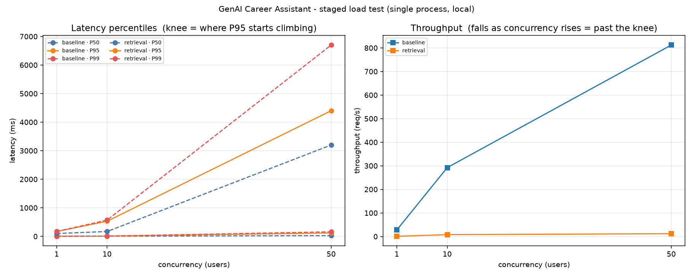

# 压测基线（可复现）

> 目标：把"这个系统能扛多少"从**感觉**变成**可复现的数字**。
> 做法：locust 阶梯压测（1 → 10 → 50 并发）✗ 一次压到最高并发只会得到"超时了很多"，
> 找不到拐点 ✗ —— 而拐点才是压测唯一有价值的结论 ✓。
>
> **口径诚实说明（先读这一段再看数字）**：
> 1. 这是**本机单进程**结果 ✗ 不能当线上容量结论 ✓（线上还要叠加网关 / 网络 / 多副本 ✓）；
> 2. `baseline` 打的是 `GET /`（纯静态）✓ 它的 QPS 只能证明"框架不是瓶颈" ✓，
>    **不代表业务吞吐** ✓ —— 真实路径里最重的是本地 embedding 与 LLM ✓；
> 3. 压测时**临时关闭了接口限流** ✓（`API_RATE_LIMIT=0`），原因见 §4 ✓；
> 4. 不含 LLM 路径 ✓（`/chat/stream` 会真调模型、烧 token ✓）✓ 需要时加 `-IncludeChat` ✓；
> 5. 每个场景**单独**跑一轮 ✓ —— 混合跑会互相抢 CPU，数据不干净 ✓。

## 一、结论先行

| 结论 | 依据 |
| --- | --- |
| **框架不是瓶颈** | `GET /` 吞吐随并发近线性上升：27.7 → 292 → **812 req/s**，P99 仅 160ms |
| **真正的瓶颈是检索链路** | 1 并发时检索就要 **100ms**（vs `GET /` 的 3ms ✓）；50 并发 P50 飙到 **3.2s** |
| **检索吞吐天花板 ≈ 12 req/s** | 本地 BGE embedding + BM25 + RRF + rerank 全链路，在 i7-12650H 上就是这个量级 |
| **50 并发已进入排队区** | 吞吐 8.1 → 11.9 req/s（增幅远小于并发增幅 5 倍 ✓），P50 从 170ms → 3200ms ✓ |
| **限流是比并发更早的一道闸** | 默认 `API_RATE_LIMIT=60`/IP/分钟 ⇒ 单 IP 上限 ≈ **1 req/s**，比上面的拐点早得多 |

## 二、原始数据

环境快照（`bench/results/env.txt` 自动生成 ✓）：

```
timestamp=2026-10-16 18:48:52
python=3.12.3   locust=2.46.7
cpu=12th Gen Intel(R) Core(TM) i7-12650H  cores=16
mem_gb=15.7
os=Microsoft Windows NT 10.0.19045.0
stages=1,10,50  duration_s=20  include_chat=False
```

| 场景 | 并发 | 请求数 | P50 | P95 | P99 | 吞吐 (req/s) | 失败率 |
| --- | --- | --- | --- | --- | --- | --- | --- |
| baseline `GET /` | 1 | 501 | 3ms | 4ms | 5ms | 27.7 | 0% |
| baseline `GET /` | 10 | 5271 | 5ms | 9ms | 10ms | 292.3 | 0% |
| baseline `GET /` | 50 | 14662 | 26ms | 120ms | 160ms | 812.2 | 0% |
| retrieval `POST /knowledge/samples/search` | 1 | 18 | 100ms | 170ms | 170ms | 1.0 | 0% |
| retrieval | 10 | 146 | 170ms | 530ms | 570ms | 8.1 | 0% |
| retrieval | 50 | 196 | **3200ms** | 4400ms | 6700ms | **11.9** | 0% |

（表与图都直接来自 `bench/results/*.csv_stats.csv` ✓ —— 不做手工誊抄 ✓ ✓）



左图：P50/P95/P99 随并发的变化（找拐点 ✓）；右图：吞吐（**随并发上升而下降 = 已过拐点** ✓）。

## 三、怎么读这张图

- **baseline 的 P95 在 10 并发时只有 9ms** ✓ —— 说明 FastAPI + 中间件（限流 / CORS / OTel 兜底）
  远不是瓶颈 ✓ ✓；50 并发时 P95 才到 120ms ✓，那已经是**排队**而不是单请求慢 ✓。
- **检索在 1 并发就已经 100ms** ✓ —— 这是单请求的真实成本（本地 embedding 编码 + BM25 + RRF + rerank ✓ ✓），
  也就是**业务路径的固有开销** ✓ ✓。
- **50 并发时检索 P50 = 3.2s** ✓ —— 用 Little's Law 校验 ✓：
  吞吐 11.9 req/s × 在途 50 ≈ 系统里平均有 **38 个请求在排队** ✓ ✓
  这与 P50 3.2s 吻合 ✓ ✓（说明这段时间是在排队，不是单请求变慢 ✓ ✓）。
- **拐点大致在 10–50 并发之间** ✓ —— 要更高吞吐只能：加副本（纵向已到顶 ✓）、
  或把 embedding 换回 API（用网络延迟换 CPU ✓）、或关掉 rerank ✓（实测 rerank 单独就要 ~9.5s ✓ ✓）。

## 四、压测时必须知道的两件事（都会让数字彻底失真）

### 1. 限流必须先关掉 —— 否则测出来的全是 429

第一次跑时 **195 个请求全是 429** ✓ ✓（`API_RATE_LIMIT=60`/IP/分钟 ✓）：
限流窗口是 60 秒，而每档只压 20 秒，于是**整场压测都在同一个窗口内** ✓，
10 并发以上必然触发 ✓ ✓。

这也顺带说明了一件更重要的事：**默认配置下，单 IP 的吞吐上限就是 ~1 req/s** ✓ ✓ ——
真实部署时前置网关/负载均衡必须处理这个问题 ✓（X-Forwarded-For ✓ ✓）。

> ⚠️ `load_dotenv(override=True)`：**`.env` 会覆盖进程环境变量** ✓，
> 所以 `$env:API_RATE_LIMIT=0` 是**没用的** ✓ —— 必须改 `.env` 再重启 ✓ ✓。
> `run_bench.ps1` 不会自动改你的 `.env` ✓（那是你的本机配置 ✓），请自行临时改、压完改回 ✓ ✓。

### 2. 必须预热 —— 冷启动会吞掉整个阶段

实测**首次检索 41.9 秒** ✗（要加载本地 BGE 模型 + faiss 索引 ✓），
第二次起降到 ~100ms ✓ ✓。不预热直接压，
第一个请求会把整段的时延分布带偏 ✓ —— 得到的不是系统性能，而是"模型加载有多慢" ✓。

## 五、复现

```powershell
# 依赖（属开发工具，故意不进 requirements —— 否则 CI 每次都要装绘图库）
.venv-ci\Scripts\python.exe -m pip install locust matplotlib

# 起被压服务（换个端口避开日常使用的 8000）
.venv-ci\Scripts\python.exe -m uvicorn src.api.main:app --port 8018

# 临时把 .env 的 API_RATE_LIMIT 改成 0 并重启服务（原因见 §4.1）

# 跑阶梯压测（每场景独立一轮，共 2×3×20s ≈ 2.5 分钟）
powershell -NoProfile -ExecutionPolicy Bypass -File bench\run_bench.ps1 `
    -BaseUrl http://127.0.0.1:8018 -Stages 1,10,50 -Duration 20

# 画曲线 + 打印汇总表
.venv-ci\Scripts\python.exe bench\plot_bench.py --results-dir bench\results

# 压完把 .env 的 API_RATE_LIMIT 改回去
```

产物在 `bench/results/`（已 gitignore ✓ ✓）：逐档 `*_stats.csv` ✓、`env.txt` 环境快照 ✓、
`latency.png` 曲线 ✓、`report.html` ✓ —— 入库的只有本文件与 `docs/bench_latency.png` ✓ ✓。

## 六、这套脚本踩过的四个坑（都写进 `DEV_NOTES.md` 了）

1. **不加 `--headless` 会挂死** ✓ —— locust 会尝试起 Web UI 并阻塞 ✓，脚本卡到被外部取消 ✓；
2. **`--tags` / `--class-picker` 在 2.46 上都会把类过滤成空** ✓ —— 0 请求 ✓；
   最终靠 `BENCH_SCENARIO` 环境变量把其余类的 `weight` 置 0 ✓（唯一被验证有效的排除方式 ✓）；
3. **`-u 1` 时 locust 只派一个 User 类** ✓ ✓ —— 混跑时"1 并发"那档可能整段只有 baseline ✓；
4. **画图脚本的 glob 误读 `_stats_history.csv`** ✓ —— 它也有 `Name` 字段 ✓，
   会把正确统计**覆盖成空** ✓，表全空却看不出原因 ✓。